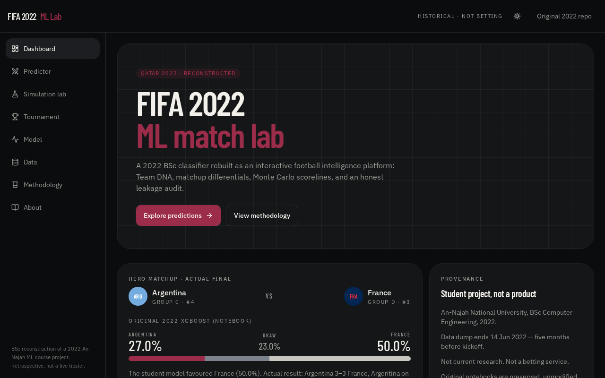
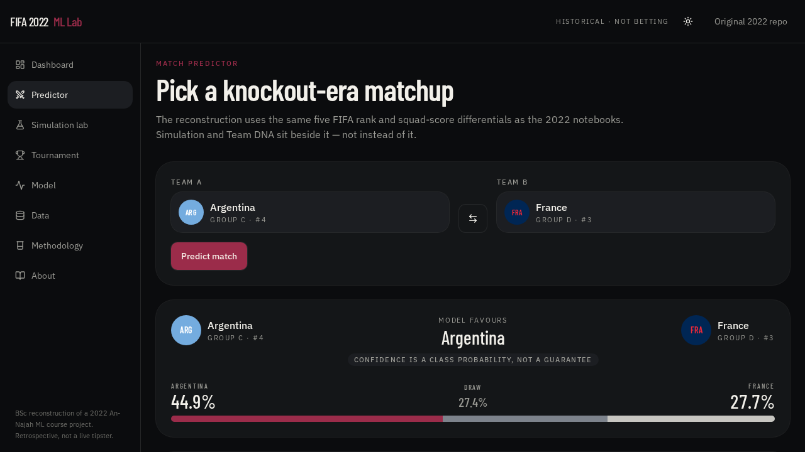
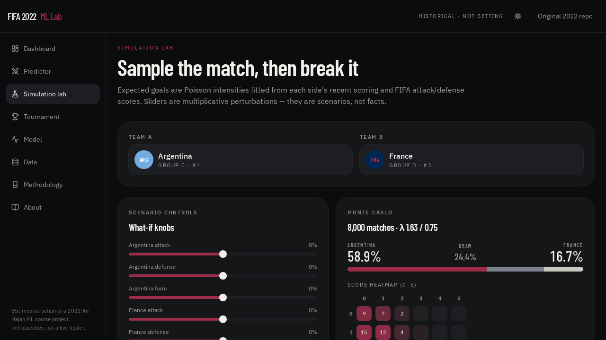
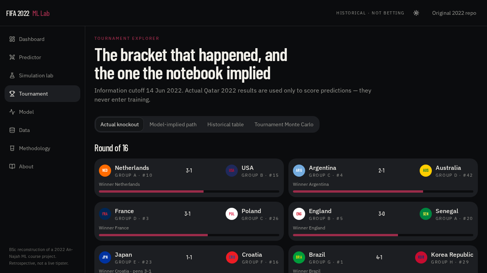
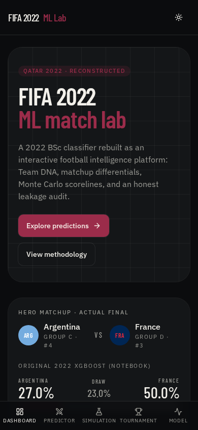
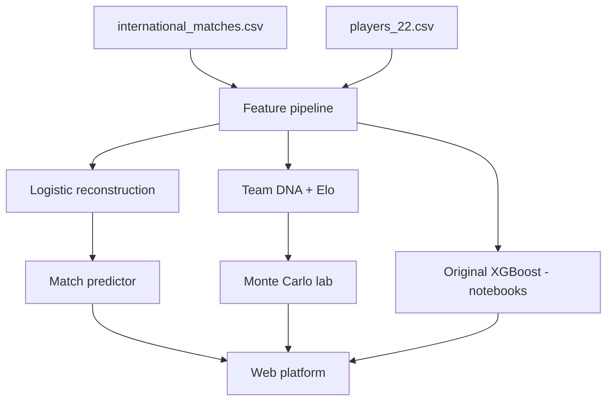

# FIFA 2022 ML Lab

**An interpretable football intelligence, simulation, and experimentation platform rebuilt around a 2022 BSc machine-learning course project.**

> Historical academic reconstruction. **Not current research. Not a betting product.**

This repository preserves the original An-Najah National University notebooks and datasets, then reconstructs the pipeline as a modern interactive lab:

**Explore → Engineer → Predict → Explain → Simulate → Challenge → Stress-test**

## Repository

- **This platform:** [ahmaddroobi99/fifa2022-ml-predictor](https://github.com/ahmaddroobi99/fifa2022-ml-predictor)
- **Original 2022 notebooks:** [ahmaddroobi99/WordCup2022_WinnerPrediction_ML](https://github.com/ahmaddroobi99/WordCup2022_WinnerPrediction_ML)

## Screenshots

| Dashboard | Predictor |
| --- | --- |
|  |  |

| Simulation lab | Tournament |
| --- | --- |
|  |  |

Mobile dashboard: 

## What this is

In 2022, `Modeling_QFIFA2022.ipynb` and `Final_Prediction.ipynb` trained an **XGBoost** classifier on historical international results plus FIFA 22 squad scores to predict FIFA World Cup Qatar 2022 matches.

This platform does **not** overwrite that work. Original notebooks live in [`notebooks/original/`](notebooks/original/). The web app:

1. Quotes the **actual notebook metrics and printed probabilities**.
2. Ships a **browser-runnable logistic reconstruction** of the same five numeric features (FIFA rank, GK, defense, offense, midfield).
3. Adds Team DNA, causal Elo, Monte Carlo scorelines, tournament rollouts, counterfactuals, walk-forward evaluation, and a leakage audit.

## Live features

- Match predictor with searchable squads and a model council
- Monte Carlo simulation lab (Poisson scorelines, scenario sliders, stress matrix)
- Tournament explorer (actual Qatar 2022 bracket vs the notebook’s implied path)
- Model analysis (notebook comparison, confusion matrix, ablation, calibration, leakage)
- Data explorer (aggregates + paginated sample — the 13MB FIFA 22 dump is not shipped to the browser)
- Methodology and provenance pages
- JSON API: `/api/health`, `/api/teams`, `/api/predict`, `/api/models`, `/api/results`, `/api/tournament`
- Dark / light theme

## Architecture

```text
Frontend (TanStack Start + React)
        │
        ▼
  /api/predict  (optional server handler)
        │
        ▼
Prediction engine (TypeScript)
  · 2022-style logistic (5 numeric diffs)
  · Elo + form
  · FIFA 22 Team DNA
  · Poisson Monte Carlo
        │
        ▼
Precomputed artifacts in src/data/
  (from Datasets/ via scripts/build-ml-artifacts.py)
```



## Original 2022 model (from the notebooks)

Quoted from `Modeling_QFIFA2022.ipynb` hold-out outputs. **Not re-estimated.**

| Setting | Model | Accuracy | n |
| --- | --- | --- | --- |
| 3-class (win/draw/lose) | Random Forest | 57% | 467 |
| 3-class | AdaBoost | 57% | 467 |
| 3-class | XGBoost (untuned) | 55% | 467 |
| 3-class | MLP | 58% | 467 |
| 3-class | **XGB tuned** γ=0.01, lr=0.01, 300 trees, depth 4 | **62%** | 466 |
| Knockout (draws dropped) | XGBoost | 78% | 722 |

Draw-class F1 on the tuned holdout: **0.02**. That is why knockout accuracy looks better.

Pipeline: `OneHotEncoder(Team1, Team2) + StandardScaler(with_mean=False) + XGBClassifier`. Feature dimension with dummies: **404**. Training rows: **9,321**.

Printed actual-final prediction (notebook): **France 50.0% / Draw 23.0% / Argentina 27.0%**. Actual result: Argentina 3–3 France, Argentina on penalties.

Group-stage score vs 90-minute results: **26 / 48** strict hits (draws count as misses; the model almost never predicted a draw).

## Reconstruction metrics (this repo)

Computed by `scripts/build-ml-artifacts.py` from `training.csv` and `international_matches.csv`.

| Protocol | Accuracy |
| --- | --- |
| Logistic, 5 numeric diffs, random holdout | 62.7% |
| Same, knockout (no draws) | 74.7% |
| Rank-only ablation | 61.2% |
| Walk-forward 2018–2022 | 52–63% depending on year |
| Chronological train ≤2020 / test 2021–22 | 61.5% |

Adding snapshot Elo + Team DNA on the WC-team subset **did not beat** the five-feature logistic. That result is shown, not hidden.

## Data

| Table | Rows | Notes |
| --- | --- | --- |
| `international_matches.csv` | 23,921 | 1993-08-08 → **2022-06-14** |
| `players_22.csv` | 19,239 | FIFA 22. **0 Qatar players** |
| `training.csv` | 9,321 | WC-nation matches after NA fill |
| `last_team_scores.csv` | 32 | June 2022 FIFA window |
| `squad_stats.csv` | 32 | Best-XI overall / potential |

Information cutoff is five months before kickoff. Tournament outcomes are used only to **score** predictions.

## Leakage (mandatory)

- One-hot team names let the original model memorize identity.
- Random splits mix eras.
- `groupby(team).mean()` NA fill can use future ratings.
- Inference reordered the stronger side into Team1 (home in training).
- FIFA 22 ratings are a video game, not tracking data.

See the Model page in the app for the full audit.

## Local development

```bash
npm install
npm run dev
```

The app listens on port 8080. Rebuild artifacts after changing source CSVs:

```bash
python3 scripts/build-ml-artifacts.py
```

Tests:

```bash
npm test
```

## Deployment

Production target is **Vercel** (TanStack Start + Nitro). The GitHub repository is:

**https://github.com/ahmaddroobi99/fifa2022-ml-predictor**

`netlify.toml` is included for a future Netlify import. A Netlify site named `fifa2022-ml-predictor` was created on the connected account, but the production deploy was **skipped due to account credit usage exceeded** — so there is no verified Netlify URL yet. Linking the GitHub repo from the Netlify UI will deploy it once credits/billing allow.

```bash
npm run build
```

Do not commit secrets. The app needs no API keys.

## Tech stack

- Frontend: React 19, TanStack Start/Router, Tailwind v4, Recharts
- ML reconstruction: TypeScript logistic + Poisson Monte Carlo (browser)
- Original training: Python, Jupyter, scikit-learn, XGBoost
- Artifact builder: `python3 scripts/build-ml-artifacts.py` (`requirements.txt`)

## Provenance

BSc Computer Engineering, An-Najah National University, 2022. Original repository: [ahmaddroobi99/WordCup2022_WinnerPrediction_ML](https://github.com/ahmaddroobi99/WordCup2022_WinnerPrediction_ML). Current work: [github.com/ahmaddroobi99](https://github.com/ahmaddroobi99).
